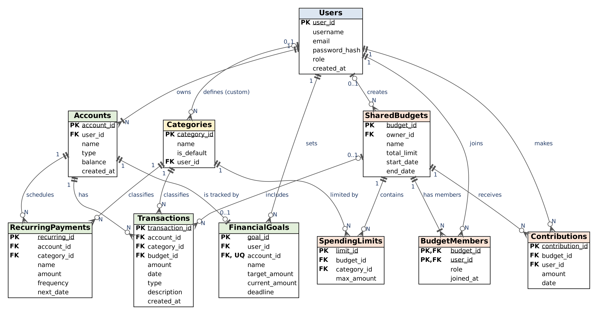

# CommonCents – Personal Finance & Shared Budget Tracker

**BBF 302E Database Systems · Fall 2026 · Term Project**
Team: **CommonCents** · Course section: 12495

CommonCents is a web application (Flask + PostgreSQL, raw SQL only) for managing personal finances and shared budgets. Users track income and expenses across their own accounts, set savings goals and recurring payments, and create shared budgets with other people (roommates, couples, families) with category spending limits, member contributions and budget-vs-limit tracking.

## Team

| Member | Role in the team | Tables | Functional req. | Non-functional req. |
|---|---|---|---|---|
| Işıl Altınışık (team leader) | Team Lead & Auth/Security Owner | Users, SharedBudgets | FR-01, FR-04 | NFR-01 |
| Mehmet Arda Öncel | Core Transactions & Query/Code Quality Lead | Transactions, Categories | FR-03, FR-05, FR-11 | NFR-04 |
| Ahmet Selim Şahintürk | Database Architect & Performance/Reliability Owner | Accounts, FinancialGoals | FR-02, FR-06, FR-10 | NFR-03, NFR-06 |
| Semih Tutuş | Spending Controls & Recurring Payments Lead | SpendingLimits, RecurringPayments | FR-07, FR-08 | NFR-05 |
| Safa Oğuzhan Dişbudak | Shared Budget Collaboration & UX Lead | BudgetMembers, Contributions | FR-09, FR-12 | NFR-02 |

## Features (scope)

- Registration, login/logout, session-based authentication, roles (**Admin**, **Budget Manager**, **User**)
- Personal accounts (cash, bank, credit card, savings) and income/expense transactions with automatic balance updates
- Default and custom categories
- Savings goals with progress tracking
- Recurring payments recorded automatically by a daily job
- Shared budgets: members, roles, category spending limits, contributions
- Spending-history analysis (by month and category) and budget-vs-limit tracking

**Out of scope:** real bank/payment connections, multiple currencies, investment tracking, mobile app, e-mail notifications.

## Technology stack

| Part | Choice |
|---|---|
| DBMS | PostgreSQL (SQLite is not used) |
| Web framework | Flask (Python) with Jinja templates |
| Database driver | psycopg2 – **raw SQL only, no ORM** |
| Authentication | Session-based (`/login`, `/register`) |
| Sample data | Python script using the Faker library |

## Repository contents

```
.
├── README.md
├── schema.sql          # PostgreSQL schema – 10 tables (Milestone 2)
├── docs/
│   ├── BBF302E_Milestone1_Proposal.pdf
│   ├── BBF302E_Milestone2_CommonCents.docx   # ER diagram & data model design
│   └── ER_Diagram.png
└── (Flask application, data-population script and requirements.txt
     will be added by the team members during Milestone 3)
```

## Database

The data model has 10 related tables: `Users`, `Accounts`, `Categories`, `Transactions`, `SharedBudgets`, `BudgetMembers`, `SpendingLimits`, `Contributions`, `FinancialGoals`, `RecurringPayments`. The full ER diagram, relationship/cardinality tables, column-level schemas, CRUD plan and complex-query plan are in [`docs/BBF302E_Milestone2_CommonCents.docx`](docs/BBF302E_Milestone2_CommonCents.docx).



### Create the database

Requires PostgreSQL 13 or newer.

```bash
createdb commoncents
psql -d commoncents -f schema.sql
```

`schema.sql` drops and recreates all tables, so re-running it resets the database (development only).

## Team working rules

- Every member works in this shared repository and commits **their own work with their own GitHub account**; nobody commits code on behalf of another member.
- Commit at least once a week, with clear commit messages that describe the change.
- All queries are written in raw SQL with parametrized inputs; the code must pass `flake8` with 0 errors.
- Secrets (passwords, `.env` files) are never committed.
- Run `git pull` before starting work to avoid conflicts.

## Milestones

| Milestone | Content | Status |
|---|---|---|
| 1 | Project proposal and group formation | Done |
| 2 | ER diagram and data model design | Done (`docs/`, `schema.sql`) |
| 3 | Database queries and web app development | Next |
| 4 | Demo, presentation and documentation | Planned |
